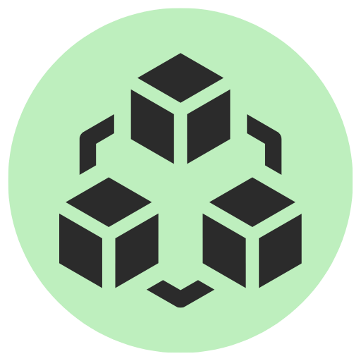

# Polonio



Polonio es una plataforma de entrenamiento en **seguridad Web3** centrada en los *smart contracts*. Despliega contratos vulnerables en un nodo **Ethereum local** y practica ataques reales en un entorno totalmente aislado, tanto de forma individual como dentro de los cursos de la plataforma de [`Offensive Skills`](https://offs.es).

> Toda la cadena de bloques se ejecuta **localmente** sobre [Anvil](https://book.getfoundry.sh/anvil/) (Foundry). No se envían transacciones a ninguna red pública: puedes experimentar y romper cosas sin ningún riesgo.

---

## Instalación

Puedes descargar directamente el paquete `.deb` incluido en la [página de releases](https://github.com/Offensive-Skills/Polonio/releases) para instalar Polonio de forma rápida en sistemas basados en Debian/Ubuntu.

### Requisitos previos

- **Docker:** Polonio levanta el nodo Anvil usando la imagen oficial de Foundry (`ghcr.io/foundry-rs/foundry:latest`). Si tienes el binario `anvil` instalado de forma nativa, Polonio lo usará automáticamente y Docker no será necesario.

  > ***Nota:***
  > Si no tienes Docker instalado, sigue las instrucciones en [la documentación de Docker](https://docs.docker.com/get-docker/).

- Actualiza tus repositorios y paquetes:
  ```bash
  sudo apt update && sudo apt upgrade -y
  ```

### Instalación del paquete

1. Dirígete a la [página de releases](https://github.com/Offensive-Skills/Polonio/releases) y descarga el `.deb` de la versión que desees.
2. Instala el paquete descargado:
   ```bash
   sudo dpkg -i polonio_x.y.z_amd64.deb
   ```
   *(Reemplaza `polonio_x.y.z_amd64.deb` por el nombre del archivo descargado.)*
3. Si faltan dependencias, corrígelas con:
   ```bash
   sudo apt install -f
   ```

---

## Ejecución

Una vez instalado, puedes ejecutar Polonio desde el menú de aplicaciones o desde la terminal con:

```bash
polonio
```

> ***Nota Importante:***
> Necesitas **credenciales** válidas para acceder a Polonio. Para obtenerlas:
> 1. Regístrate o inicia sesión en la [página de Offensive Skills](https://offs.es/escritorio).
> 2. Accede a la [gestión de API Tokens](https://offs.es/escritorio/api-token) para obtener tu token.
>
> **Campos solicitados al iniciar sesión:**
> - `usuario`: Tu nombre de usuario en [Offensive Skills](https://offs.es/escritorio).
> - `token`: El token asociado a tu cuenta, visible en la [página de API Tokens](https://offs.es/escritorio/api-token).

### Uso rápido

1. Inicia sesión con tu usuario y token.
2. Pulsa **Iniciar Nodo** en la barra superior para levantar la cadena local.
3. Ve a **Retos**, busca uno por nombre o filtra por nivel, selecciónalo y pulsa **Desplegar**.
4. Lee el código fuente del contrato en el panel derecho.
5. Usa la **Consola** para escribir y desplegar tu *exploit* (JavaScript con `web3` o Solidity).
   - El panel **Contratos desplegados** lista todos los contratos (del reto y tuyos): haz click en una dirección para copiarla.
   - **Interacción rápida** genera un campo por parámetro a partir del ABI y permite enviar transacciones raw (calldata/ETH) para alcanzar `fallback`/`receive`.
   - La pestaña **Código Fuente** muestra el código exacto de cada despliegue, incluidos los tuyos, y permite reabrirlo en el editor para corregirlo.
6. Pulsa **Verificar solución** cuando creas haberlo resuelto.

---

## Desarrollo

### Ejecutar Polonio en modo desarrollo

Para ejecutar Polonio desde el código fuente:

```bash
git clone https://github.com/Offensive-Skills/Polonio.git
cd Polonio
npm install
npm start
```

Requisitos para desarrollo: **Node.js 18+** y Docker (o `anvil` nativo).

### Abrir herramientas de desarrollador

Para abrir las DevTools de Chromium (inspector, consola, etc.), inicia la app con el flag `--dev`:

```bash
npm run dev
```

---

## Arquitectura


El proceso *main* orquesta el nodo local, la compilación con `solc`, el despliegue e interacción con contratos vía `web3`, y la comunicación con la API de contenidos. El *renderer* solo se comunica a través de un `contextBridge` restringido (`window.polonio.*`); no tiene acceso a Node.js.

Estructura del proyecto:

```
Polonio/
├── main.js                 # Proceso principal de Electron + handlers IPC
├── preload.js              # contextBridge (window.polonio.*)
├── views/app.{html,js}     # Interfaz (SPA)
├── views/render.js         # Markdown (marked + DOMPurify) y resaltado Solidity (highlight.js)
├── assets/css/             # Estilos
├── blockchain/             # web3Provider, contractService, storageService, inspector…
├── forge/anvilService.js   # Ciclo de vida del nodo Anvil (nativo o Docker)
├── challenges/             # challengeEngine, validator
├── compiler/               # Envoltorio de solc + resolución de imports
├── controllers/            # authController
└── utils/                  # logger, descripción de errores (reverts)
```


## License

Polonio © 2026 by Offensive Skills is licensed under Creative Commons Attribution-NonCommercial-ShareAlike 4.0 International.

Consulta más detalles sobre la licencia en el archivo [`LICENSE`](./LICENSE.md).
